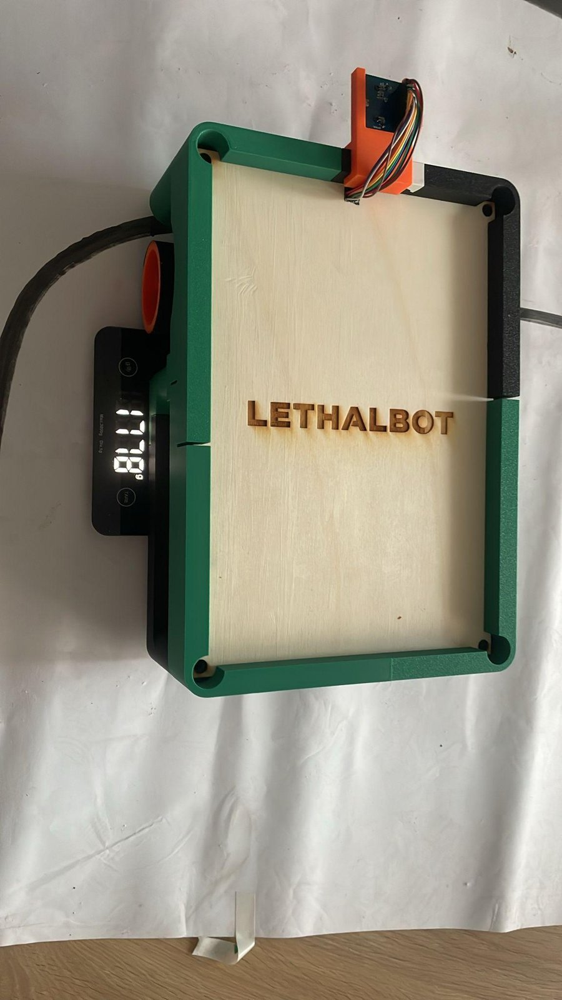
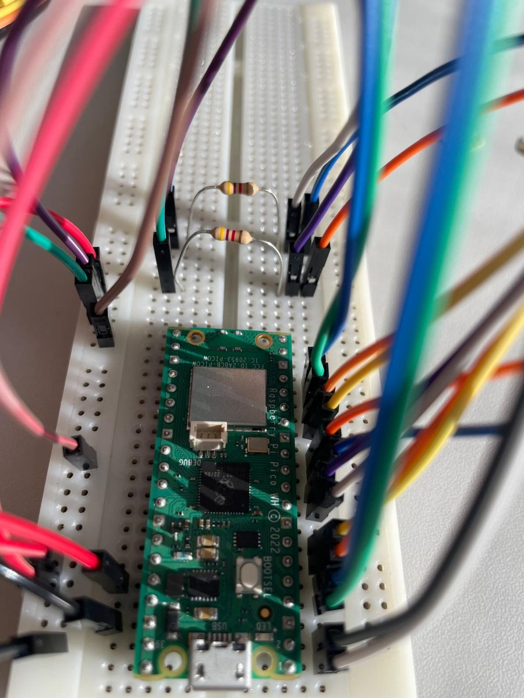
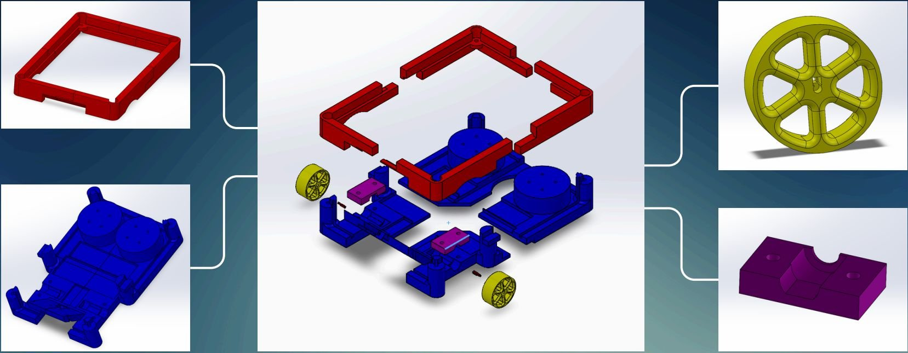

# LethalBot: autonomous line-following robot

PRONTO project, first year at IMT Atlantique (February - May 2026), team of five.

LethalBot is an autonomous wheeled base that follows a black line on the floor using only a low-resolution camera. It carries up to 20 kg while weighing less than 2 kg (1.78 kg on the scale above) and runs CircuitPython on a Raspberry Pi Pico W.

## Project website

The mechanical design, CAD files and build log are on the project site: **[lethalbot.pages.dev](https://lethalbot.pages.dev/)**.

It is a single page with an interactive 3D viewer of the robot (assembled and exploded), a line-following and control-law demo, the code explained, the battery and interface, the manufacturing steps, a filterable parts list, the electronics block diagram and the Pico pin assignments. The SolidWorks, STEP, Blender, Inkscape, STL and code files can be downloaded from its Sources section.

## Design
- **Mechanics**: SolidWorks and Blender modelling, 3D printing and laser cutting at the FabLab.
- **Electronics**: Raspberry Pi Pico W and OV7670 camera.
- **Software**: CircuitPython, line detection by linear regression on the camera image.
- **Web**: design and deployment of the project website.

## How it follows the line

The camera (OV7670) is read at 40 × 30 pixels, a sixteenth of its full resolution in each direction, so the Pico can process every frame.

1. **Threshold per row.** Each row of the image gets its own black/white threshold, halfway between its darkest and brightest pixel. Rows with too little contrast are ignored, so uneven lighting matters much less than with a single threshold for the whole frame.
2. **Fit the line.** A least-squares regression through the black pixels gives the line as `u = a·v + b`: `b` is how far the line sits to the left or right of the robot, `a` is which way it bends further ahead.
3. **Steer.** `correction = 2·b + 5·a` is added to one wheel's speed and taken from the other, so the robot both re-centres and anticipates the turn.
4. **Drive through the dead zone.** Below about 20 % PWM the gear motors do not move the robot at all, so slow speeds are impossible with plain PWM. The final program uses *macro-PWM*: in each 150 ms cycle both motors run above the dead zone, and each one is switched off early in proportion to the speed it should have. At start-up the robot finds the dead zone itself by ramping up the PWM until the wheel encoders move.

The robot has four states, shown on the OLED screen: waiting for the start button, following the line, searching (backing up until it finds the line again), and arrived (the whole floor turns black at the end of the course).

## What's in the repo

| Path | What it is |
|---|---|
| `pico/robot_ligne.py` | **The final program.** Pulsed macro-PWM; the most reliable version. |
| `pico/robot_ligne_continu.py` | Continuous speed control: smoother, but loses the line in tight turns. |
| `pico/robot_ligne_continu_rapide.py`, `pico/robot_ligne_bas.py` | Variants of the two above. |
| `pico/code_barycentre.py` | First version: steer toward the centroid of the black pixels. |
| `pico/code_regression.py` | Second version: the linear regression. |
| `pico/Code_avec_PID*.py`, `pico/code.py`, `pico/code_fixed.py` | Attempts at speed control with a PID loop and speed tables measured on the motors. |
| `pico/test_*.py`, `pico/calibration.py` | Tests for the button, camera and motors. |
| `viewer_camera.py`, `camera/` | PC-side tools: stream the camera image over USB to check what the robot sees, regression prototypes, and `plot_vitesse.py` to plot the motor speed tests. |
| `moteur/` | The first motor drivers. |
| `docs/` | Photos used in this README. |

Comments and names in the code are in French.

## Running it

1. Install [CircuitPython](https://circuitpython.org/board/raspberry_pi_pico_w/) on the Pico W.
2. From the [Adafruit library bundle](https://circuitpython.org/libraries), copy these into `lib/` on the board: `adafruit_ov7670`, `adafruit_displayio_sh1106`, `adafruit_display_text`, `adafruit_bus_device`.
3. Copy `pico/robot_ligne.py` to the board as `code.py`.

Wiring used by the final program: camera data on GP0-GP7, PCLK GP10, XCLK GP11, HREF GP12, VSYNC GP13, camera I2C on GP8/GP9; motors through a Digilent PmodDHB1 (direction GP14/GP15, PWM GP16/GP17); encoders GP18-GP21; OLED (SH1106) I2C on GP26/GP27; start button GP22; status LED GP28.

## Team

- Marin de Vanssay: programming and computer vision
- Valentin and Malo: 3D and electrical modelling
- Kellian: electronic circuit
- Xhanet: documentation and organisation

## Credits

The code in `pico/`, `camera/`, `moteur/` and `viewer_camera.py`, and the photos in `docs/`, come from the team repository by Marin de Vanssay, who wrote the code: [Marin-dv/lethalbot](https://github.com/Marin-dv/lethalbot).

## Author
Valentin Lachaise, engineering student at IMT Atlantique.
Personal website: https://vlachaise.pages.dev

## License
MIT (see [LICENSE](LICENSE)).
